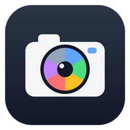
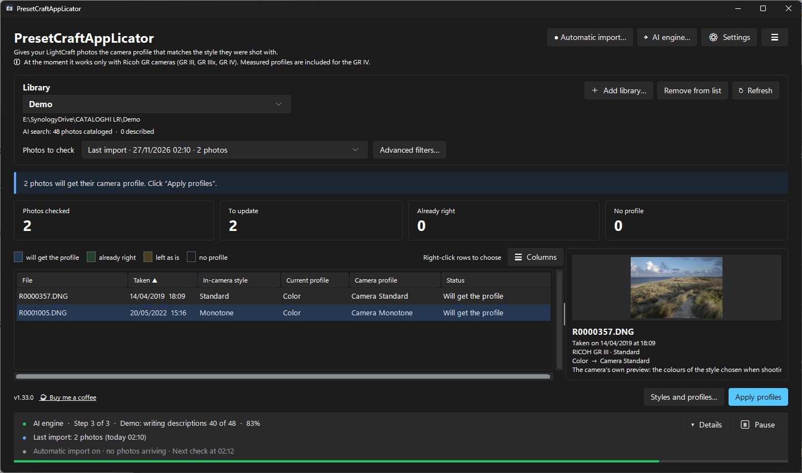
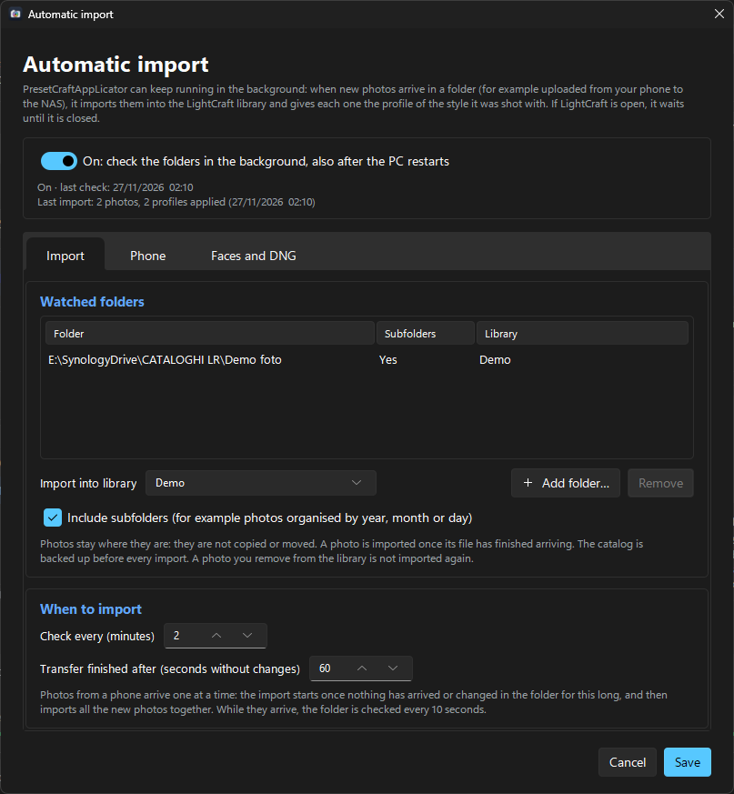
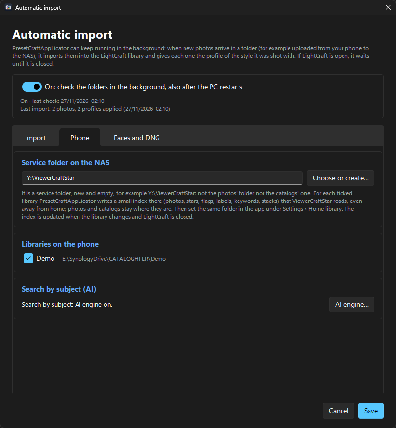
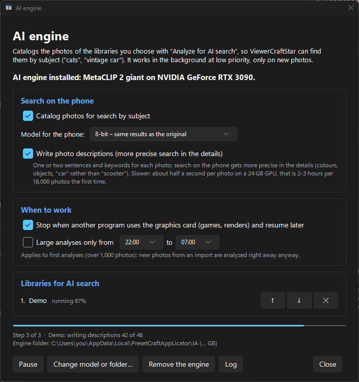
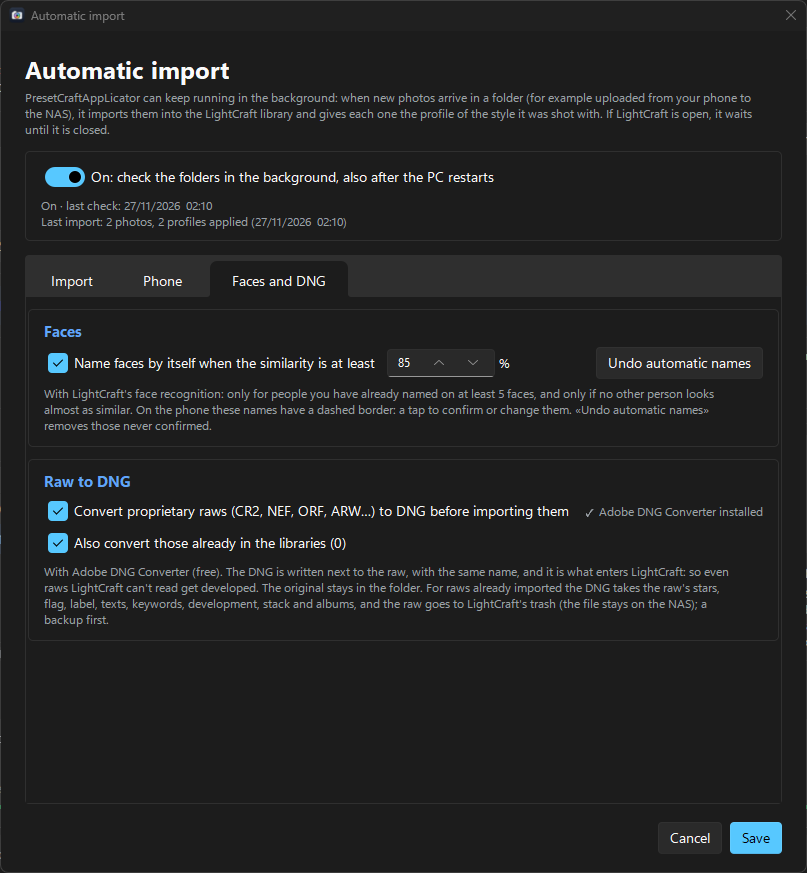
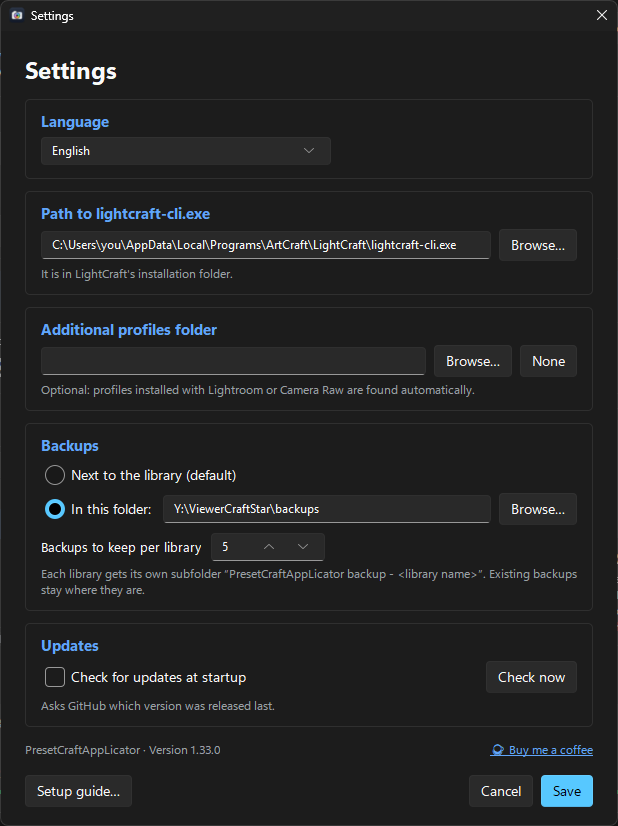

<p align="center"></p>

<h1 align="center">PresetCraftAppLicator</h1>

<p align="center">
Automatic import into <b>LightCraft</b> from a NAS folder, your libraries on the phone with search by subject — and, for
Ricoh GR cameras, the camera profile that matches the style you shot with.<br>
<a href="#-italiano">🇮🇹 Italiano</a> · <a href="https://github.com/poty87/PresetCraftAppLicator/releases/latest">⬇ Download</a> · <a href="https://buymeacoffee.com/poty87">☕ Buy me a coffee</a> · <a href="https://paypal.me/poty87">PayPal</a>
</p>

> PresetCraftAppLicator is an independent tool. It is not made by, affiliated with or endorsed by the authors of
> [LightCraft](https://github.com/storytold/lightcraft), Ricoh, Pentax or Adobe.

> [!NOTE]
> **Camera profiles** are for **Ricoh GR** cameras only for now (GR III, GR IIIx, GR IV, DNG files; the measured profiles
> are included for the GR IV). Everything else — automatic import, libraries on the phone, search by subject, faces, raw to
> DNG, changes made on the phone — works with the photos of any camera LightCraft opens, and with any NAS with an SMB
> shared folder.

## Screenshots

<p align="center"></p>

<table>
<tr><td align="center"><br><sub>Automatic import</sub></td><td align="center"><br><sub>Libraries on the phone</sub></td><td align="center"><br><sub>AI engine for search on the phone</sub></td></tr>
<tr><td align="center"><br><sub>Faces and raw to DNG</sub></td><td align="center"><br><sub>Settings</sub></td><td></td></tr>
</table>

<sub>Screenshots taken on a demo library: free photos from [Unsplash](https://unsplash.com/license) (via Lorem Picsum) and Ricoh GR sample raws from [raw.pixls.us](https://raw.pixls.us/) (CC0).</sub>

## Part of a suite

This app is one of three independent tools that, together, build a **workflow for [LightCraft](https://github.com/storytold/lightcraft)
with your photos on a NAS** — any NAS or server with an SMB shared folder (Synology, QNAP, TrueNAS, Unraid, a Windows
share…): bring the photos home, import them with the right colours, browse and edit your library from the phone, and keep
the NAS clean. Each one works on its own; together they cover the whole path.

| App | Runs on | What it does |
|---|---|---|
| [**PresetCraftAppLicator**](https://github.com/poty87/PresetCraftAppLicator) | Windows PC | Watches a NAS folder and imports new photos into LightCraft automatically; applies the ratings, flags, metadata and presets chosen on the phone; puts your libraries on the phone, with optional search by subject (AI). For Ricoh GR cameras it also gives each photo the camera profile of the style it was shot with. |
| [**ViewerCraftStar**](https://github.com/poty87/ViewerCraftStar) | Android | Browse, search and edit your whole LightCraft libraries on the phone. Optionally import new photos on the phone too (from a Ricoh GR camera or from an external disk), review them (flags, stars, labels, metadata, presets with preview) and send them to the NAS, following them until they are safe at home. |
| [**CleanCraftNas**](https://github.com/poty87/CleanCraftNas) | Windows PC | Deletes from disk — even on the NAS — the photos you put in LightCraft's trash, so the NAS stays in step with the library. |

**Which cameras.** The suite works with the photos of most cameras: whatever LightCraft opens (DNG, CR2/CR3, NEF, ARW,
ORF, RAF, JPEG…; PresetCraftAppLicator can also convert proprietary raws to DNG with the free Adobe DNG Converter). For now
only two things are specific to **Ricoh GR** cameras:
- giving each photo the camera profile of its picture style (PresetCraftAppLicator);
- downloading photos straight from the camera over Wi-Fi (ViewerCraftStar). The same import also works from an external
  disk or card reader plugged into the phone, with the raw files of any camera LightCraft opens (CR2, NEF, ARW, RAF,
  ORF, RW2, PEF, DNG…) and JPEGs. Formats the phone itself doesn't recognise as photos (on Android 17, Canon CR3) go
  through the PC.

**Two ways to bring photos home**

- **The classic way, from the PC.** Copy the photos to the NAS as you always do (card reader, the camera's software, any
  sync tool): PresetCraftAppLicator imports them from the watched folder. You can still browse, search, rate and edit them
  from the phone, because the phone shows the whole library, not only what it sent.
- **From the phone — a plus, not a requirement.** Import from the camera or an external disk, review on the phone and
  *Send to the NAS*: the app moves the photos to a phone folder that your NAS's sync or backup app uploads (for example
  Synology Drive, QNAP Qfile, Nextcloud, Syncthing) and writes your choices next to them (`.xmp`).

Then edit in LightCraft; the photos you don't want go to LightCraft's trash, and **CleanCraftNas** deletes them from the
NAS too.

**Away from home** the phone reaches the NAS through a VPN to your home network (OpenVPN, built into ViewerCraftStar): see
the [remote access guide](https://github.com/poty87/ViewerCraftStar/blob/main/docs/remote-access.md). The guide uses Synology's *VPN Server* as an example, but any
OpenVPN server works (a router, another NAS brand, a PC).

## Why it exists

Many cameras let you pick a picture style when you shoot. Ricoh GR cameras call it *Image Control*, with styles such as
Positive Film, Negative Film or Hard Monotone. The style is applied to the JPEG and to the preview embedded in the raw file,
**but not to the raw data**.

That is why, when you open a raw photo in [LightCraft](https://github.com/storytold/lightcraft), the colours first look
right (LightCraft shows the camera's embedded preview), and a moment later they change: LightCraft then develops the raw file
with its own default profile, which knows nothing about the style you chose.

Adobe publishes **Camera Matching** profiles (`.dcp`) that reproduce each camera's styles, and they are installed together
with Lightroom or Camera Raw. LightCraft can use `.dcp` profiles, but it cannot tell which style each photo was shot with.

PresetCraftAppLicator does that part:

1. it reads, from every raw file, the style chosen in the camera (it is stored in the manufacturer's notes inside the file);
2. it finds the matching Camera Matching profile (`Camera Positive Film` for Positive Film, and so on);
3. it imports the profiles into the LightCraft library and gives each photo its own one.

Only the profile changes: exposure, white balance and every other adjustment stay as they are.

## How to use it

1. Import your photos into LightCraft as usual, then **close LightCraft**.
2. Open PresetCraftAppLicator and choose the library.
3. Choose which photos to check:
   - **Last import**: only the photos of the latest import (the usual choice after an import).
   - **From the … import onwards**: one of the recent imports and everything imported after it — handy after two
     imports in a row. The menu lists the last 5 imports with their date, time and number of photos (pieces of the same
     import a few minutes apart count as one).
   - **Whole library**: every photo.
   - **Advanced filters…** (next to the menu): the history of every import, which you can narrow down with a date range
     (pick the days from a calendar, where days with imports are blue) and, optionally, times; then check all the photos
     imported in that range, or only the imports you select.
4. The list shows, for each photo:
   - the style it was shot with;
   - its current profile;
   - the camera profile it will get.

   Click a row to see the camera's own preview, with the colours of the style chosen when shooting.
5. Click **Apply profiles** and confirm. A copy of the catalog is saved first. Then open LightCraft.

| Colour | Meaning |
|---|---|
| blue | the photo will get its camera profile |
| green | it already has the right profile |
| yellow | it is left as it is (right-click › *Leave as is*, or a profile you chose by hand in LightCraft) |
| no colour | no profile for its style, the style can't be read, or the file is missing |

Photos where you already chose a different profile in LightCraft are **not touched** unless you right-click them and choose
*Apply the profile*.

To give a different profile to **some photos only**, select them, right-click and choose *Choose the profile for this
photo…*: the list shows "· this photo only" next to the profile, and nothing else changes — other photos with the same style
and the photos that automatic import brings in keep following the style's rule. *Change the profile of every photo with
this style…* instead changes the rule for that camera style: it applies to every photo with that style, including future
automatic imports, and asks for confirmation first.

## Automatic import

If your photos land in a folder on their own (for example the raw files uploaded from your phone to a NAS), PresetCraftAppLicator
can watch that folder in the background, import the new photos into the LightCraft library and give each one its camera
profile. When you open LightCraft, the photos you just shot are already there, with the right colours.

1. Click **Automatic import…**.
2. Choose the library, click **Add folder…** and pick the folder where new photos arrive. Leave **Include subfolders**
   ticked if your photos go into subfolders (for example by year, month or day): new subfolders are picked up too.
   If the folder already holds photos that are not in the library, you choose whether to import them too or ignore them.
3. Tick **On** and click **Save**.

How it works:
- a scheduled task starts it in the background when you sign in to Windows (no administrator rights);
- when nothing is arriving it checks the folders every few minutes (2 by default);
- **a transfer is imported in one go.** Photos from a phone arrive one at a time, so as soon as new files show up the
  folder is checked every 10 seconds, and the import starts only when nothing has arrived or changed for a while (60
  seconds by default). All the new photos are then imported together, with a single catalog backup;
- photos are added where they are: nothing is copied or moved;
- if LightCraft is open, it waits until you close it (and if you open LightCraft halfway, the rest is finished later);
- the catalog is backed up before every import, and every import is written to the log;
- a photo you remove from the library is not imported again;
- photos that arrive in the folder and that you import yourself also get their profile.

### Ratings and flags from the phone (ViewerCraftStar)

ViewerCraftStar, a companion Android app, writes `.xmp` files next to the DNG files on the NAS with the flag, stars, colour
label, title, caption, keywords, creator and copyright you set on the phone. Automatic import picks them up: new or
changed `.xmp` files written by ViewerCraftStar are applied to the photos already in the library (removing a value
works too), and photos imported later get them as well. `.xmp` files written by LightCraft or other programs are left
alone, and the photo's profile is never touched.

ViewerCraftStar can also pick a **preset** for each photo, from the library's own presets (for example the GR IV styles or
presets imported from Lightroom): PresetCraftAppLicator publishes the list in a hidden `.viewercraftstar` folder inside the
watched folder, and applies the chosen preset in LightCraft (develop settings reset, the camera-style profile, then the
preset). Photos with a preset chosen on the phone are never given the automatic profile again: the app's list shows them
as *Preset chosen on the phone*.

Presets can also be **imported from the phone**: ViewerCraftStar uploads the chosen files (Lightroom `.xmp` presets,
`.lrtemplate`, `.lcpreset`, Luminar looks or `.zip` bundles of these) to `.viewercraftstar/import`, and PresetCraftAppLicator
imports them into the library (group *ViewerCraftStar*) and publishes the updated list.

Finally, PresetCraftAppLicator writes a small report (`.viewercraftstar/status.json`) saying which photos of the watched
folder are in the library and which version of the phone's metadata has been applied (right after an import, without
waiting for the next check), plus a heartbeat (`.viewercraftstar/heartbeat.json`, at most once a minute) so the phone
knows whether the home PC is on. ViewerCraftStar shows a green house for photos already in LightCraft and a blue house
for photos whose DNG and latest metadata are safe on the NAS: both can be moved to the phone's bin, and blue ones enter
LightCraft as soon as the home PC is on — useful when travelling with the PC off.

### Libraries on the phone (ViewerCraftStar)

In **Automatic import…**, under *Libraries to browse on the phone*, choose (or create) a **new, empty service folder** on the
NAS — for example `Y:\ViewerCraftStar`, not the photos' folder nor the catalogs' one — and tick the libraries you want to
see in ViewerCraftStar's *Library* section (the list shows the libraries added with *Add library*). In the app, set the same
folder under *Settings › Home library*. For each one PresetCraftAppLicator writes a small index there
(`<library name>/index.json.gz`: photos, stars, flags, labels, title, keywords, camera data and stacks — about 0.3 MB for
18,000 photos). It is rewritten only when the library changes and LightCraft is closed, so it stays valid while the PC is
off. The background process runs for this even if no folder is watched for imports.

Stars, flags, colour labels, titles, captions and keywords changed in that section of the app are left by the phone in
`<library name>/changes/` as small requests; PresetCraftAppLicator applies them to the library (with LightCraft closed,
after a catalog backup), moves them to `changes/done` and publishes the updated index, so the phone sees them confirmed.
Photos can also be **grouped into a stack** (stacks they are already in are merged) or **moved to LightCraft's trash**
(*Recently Deleted*): the files stay on the NAS, so at the PC you can still check them in LightCraft or delete them for
good with [CleanCraftNas](https://github.com/poty87/CleanCraftNas).

### Search by subject on the phone (optional AI engine)

ViewerCraftStar can find library photos by what is in them — *cats*, *vintage car*, *sunset at the beach*, in Italian or
any other language. The catalog is built on this PC by an **optional AI engine** (the
[MetaCLIP 2](https://github.com/facebookresearch/MetaCLIP) model, licensed **CC BY-NC 4.0: non-commercial use only**);
the phone only receives the result and searches offline.

- **Install it** from the setup wizard (*AI search* page) or later from **Automatic import… › AI engine…**. You choose
  the model — the recommended one depends on the graphics card (*giant* for NVIDIA cards with 16 GB, *huge* for 8 GB,
  *small* without a suitable GPU, on the processor) — and **the folder**, since it takes about 10–22 GB (programs,
  model and thumbnails). The installer stays small: the engine (a separate Python environment with PyTorch, made with
  [uv](https://github.com/astral-sh/uv)) and the model are downloaded in the background after installation; the window
  shows the progress and the download resumes where it stopped.
- **First analysis**: in the main window, under the chosen library, click **Analyze for AI search**. It shows the
  number of photos and an estimate of the time (for example about 30 minutes for 18,000 photos with *giant* on an
  RTX 3090), adds the library to the phone libraries if needed and puts it in the queue; several libraries are analyzed
  one at a time, in the order shown in *AI engine…*. **Pause/Resume** stops and resumes where it left off (also from
  the notification area icon, which shows the progress).
- **Then it's automatic**: when automatic import has added new photos and the library index is updated, the background
  process analyzes only the new photos of the libraries already analyzed, at low priority, and a Windows notification
  says how many were cataloged. Options: **stop when another program uses the graphics card** (games, renders) and
  resume later; **time window** for large analyses (for example 22:00–07:00 — new photos after an import are done
  right away anyway).
- **What it writes**: the engine reads the previews embedded in the files (photos and catalogs are never modified) and writes in the
  phone folder, next to each library's index, `<library name>/ia/`: `visivo.bin` (one fingerprint per photo, about 2.5 KB
  each), `manifest.json`, and in `telefono/` the text part of the model reduced to Italian and English and compressed to
  8 bits (about 830 MB, or 4 bits) with its tokenizer, which ViewerCraftStar downloads once. If Windows resets the graphics
  driver during a long job (TDR), the engine resumes where it stopped.
- **Descriptions (optional)**: with an NVIDIA GPU of at least 12 GB the engine can also write, for every photo, one or
  two sentences and keywords in Italian or English (chosen in the AI engine window; changing it rewrites them little
  by little in the background) with [Qwen3-VL](https://github.com/QwenLM/Qwen3-VL) (8B with 20 GB or more, 4B
  with 12 GB; Apache 2.0) in `<library name>/ia/descrizioni.json.gz`. On the phone, photos whose description contains
  the words searched for move up, the others move down a little: search gets more precise in the details (colours,
  objects, a car rather than a scooter). They are slower — about half a second per photo on an RTX 3090, 2-3 hours per
  18,000 photos the first time — so they run after the fingerprints, with the same pause, GPU-busy and time-window rules.
  Turn them on in the setup wizard or in *AI engine…* (the model, 9-18 GB, is downloaded the first time).
- **Updates** of PresetCraftAppLicator do not touch the engine; the *AI engine* window lets you change model or folder
  (the engine is moved, not downloaded again), reorder or remove libraries, turn it off, or remove it.

### Notification area icon

While automatic import is on, an icon sits in the notification area. Its dot shows the state: **green** = on and
waiting for photos, **blue** = photos arriving or being imported, **yellow** = waiting for LightCraft to be closed,
**red** = error. Hover it for a short status.

- **Double-click** opens PresetCraftAppLicator.
- **Right-click** shows what it is doing right now (photos arriving, *Importing: 4 of 12 photos*, time left, last
  import) and the commands *Check now*, *Open log* and *Quit* (it starts again at the next sign-in).
- A Windows notification tells you when the photos have been imported.

The icon uses [pystray](https://github.com/moses-palmer/pystray) (LGPLv3).

## Uninstall

Uninstall from **Settings › Apps › Installed apps** (or run the setup again). PresetCraftAppLicator's own uninstall
wizard opens. It removes the program, its shortcuts and the automatic import (background process, icon and scheduled
task), and can delete your settings and log too. If the AI engine is installed it asks whether to remove it as well
(programs, models and thumbnails, wherever you put it) and, separately, its search files in the phone folder. Your photos,
your LightCraft libraries and the catalog backups next to them are never touched.

The cleanup is done by the installer package itself, so it also happens with `msiexec /x` or a silent uninstall
(`PresetCraftAppLicator-Setup-x.y.z.exe --silent --uninstall [--remove-data] [--remove-ai] [--remove-ai-nas]`). A silent
install can add the engine with `--ai-model metaclip2-giant|metaclip2-huge|metaclip2-b16 [--ai-dir D]`. Updates stop the
background process and start it again once the new version is installed.

### Measured profiles (Ricoh GR IV)

For the GR IV, PresetCraftAppLicator also includes **measured** profiles: 3D LUTs made by comparing, photo by photo,
LightCraft's default rendering of a raw file with the preview the camera saved in the same file. The two come from the
same raw, so they match pixel for pixel.

| Style | Used by default |
|---|---|
| Standard, Vivid, Positive Film, Negative Film, Cinema (Yellow), Cinema (Green) | *Measured …*: closer to the camera than Adobe's profiles in LightCraft |
| Hi-Contrast B&W, Bleach Bypass, Retro, Cross Processing | *Measured …*: Adobe makes no profile for them |
| Monotone, Soft Monotone, Hard Monotone | Adobe's *Camera …* profile; the measured one is offered as an alternative |
| HDR Tone | not covered yet (no reference photos; its local tone mapping is not something a LUT can reproduce) |

They reproduce colour and tones only. Grain, vignetting and other local effects of some styles (Hi-Contrast B&W,
Retro…) are not part of a LUT. They were measured with the style settings at their defaults and with LightCraft's
rendering as of version 0.21. `tools/measure_styles.py` measures them again from your own photos.

### Styles without a profile

Styles whose code is not known yet show up as *Unknown style (code)*. Click **Styles and profiles…** to pick the profile
to use for each style, or to leave those photos alone. Your choices are remembered.

## Supported cameras

**Camera profiles — Ricoh GR only for now:** GR III, GR IIIx and GR IV, DNG files. It has been tested with the
GR IV, and the measured profiles exist for the GR IV only. The code can also read the style of Pentax files (DNG and PEF),
but that has not been tested.

JPEG photos are not changed, because the style is already part of the image. Photos of other cameras are imported and
handled like the others (phone, AI search, faces, metadata): they just keep LightCraft's default profile.

### Look profiles (Cinema Yellow, Cinema Green…)

Adobe ships some camera styles as **Look** profiles (`.xmp`) instead of `.dcp`: the *Camera Standard* profile plus a 3D
colour table. The GR IV's *Camera Cinema Yellow* and *Camera Cinema Green* are like that. LightCraft cannot read these
files, but it can use 3D LUTs, so PresetCraftAppLicator turns the colour table into a `.cube` LUT and imports it into a
profile group named after the camera (for example *RICOH GR IV*).

LightCraft applies a LUT to its own rendering of the photo, not on top of Camera Standard, so the result is close to the
camera's but not identical. The LUT keeps the look's colour and leaves the brightness to LightCraft. On the test photos this was
the closest match to the camera's own preview.

The Camera Matching profiles are **not included** (they belong to Adobe). PresetCraftAppLicator uses the ones already on your
PC:
- `C:\ProgramData\Adobe\CameraRaw\CameraProfiles\Camera` and `C:\ProgramData\Adobe\CameraRaw\Settings\Adobe\Profiles\Camera`,
  installed by Camera Raw, Lightroom or the free Adobe DNG Converter;
- the same folders inside the Lightroom Classic and Lightroom installation (`C:\Program Files\Adobe\…\Resources`);
- `%APPDATA%\Adobe\CameraRaw\CameraProfiles` and `%APPDATA%\Adobe\CameraRaw\Settings`;
- an extra folder you choose in **Settings**.

## Same features as CleanCraftNas

PresetCraftAppLicator is a sibling of [CleanCraftNas](https://github.com/poty87/CleanCraftNas) and shares its basics:

- several libraries in a drop-down menu;
- six languages: Italiano, English, Deutsch, Español, Français, Português;
- sortable, reorderable columns that you can show or hide;
- a backup of the catalog before every change (the last 5 are kept, adjustable in the settings), with a **Backups…**
  window to open or delete them — including *Delete backups older than N days* (1 keeps only today's);
- a log of every change (automatic imports included);
- a silent check for updates at start, with a one-click update;
- a setup wizard with the same dark look.

If your photos live on a NAS, mount the share as a drive letter as explained in the
[CleanCraftNas guide](https://github.com/poty87/CleanCraftNas#nas-setup).

## Install

Download `PresetCraftAppLicator-Setup-x.y.z.exe` from the [latest release](https://github.com/poty87/PresetCraftAppLicator/releases/latest)
and run it. It installs for your user only (no administrator rights) and includes everything it needs, Python included.
An `.msi` is attached too, for silent installs:

```
msiexec /i PresetCraftAppLicator-x.y.z.msi /qn PCA_LANGUAGE=en PCA_DESKTOP=0
```

## Build from source

Windows, Python 3.13:

```
powershell -ExecutionPolicy Bypass -File build.ps1
```

`dist\` then holds the MSI and the setup. To run from source:
`pip install sv_ttk pillow` and `python src\presetcraft.py`.

## Support the project

PresetCraftAppLicator is free and will stay free: no subscriptions, no ads, no accounts. If it is useful to you and you would like to
help me spend more time on it, you can [buy me a coffee](https://buymeacoffee.com/poty87) or donate with [PayPal](https://paypal.me/poty87). Thank you! ☕

## License

[MIT](LICENSE).

---

## 🇮🇹 Italiano

**PresetCraftAppLicator** importa da solo in **LightCraft** le foto che arrivano in una cartella del NAS, porta le tue
librerie sul telefono con la ricerca per soggetto e — con le Ricoh GR — dà alle foto il profilo della fotocamera che
riproduce lo stile con cui le hai scattate.

> [!NOTE]
> I **profili della fotocamera** per ora sono solo per le **Ricoh GR** (GR III, GR IIIx, GR IV, file DNG; i profili
> misurati sono inclusi per la GR IV). Tutto il resto — importazione automatica, librerie sul telefono, ricerca per
> soggetto, volti, conversione dei raw in DNG, modifiche fatte dal telefono — funziona con le foto di qualsiasi fotocamera
> che LightCraft apre, e con qualsiasi NAS con una cartella condivisa SMB.

Le schermate sono [in cima alla pagina](#screenshots).

### Fa parte di una suite

Questa app è uno di tre programmi indipendenti che, insieme, creano un **flusso di lavoro per
[LightCraft](https://github.com/storytold/lightcraft) con le foto su un NAS** — qualsiasi NAS o server con una cartella
condivisa SMB (Synology, QNAP, TrueNAS, Unraid, una condivisione di Windows…): porti a casa le foto, le importi con i colori
giusti, sfogli e modifichi la libreria dal telefono e tieni pulito il NAS. Ognuno funziona anche da solo; insieme coprono
tutto il percorso.

| App | Dove gira | A cosa serve |
|---|---|---|
| [**PresetCraftAppLicator**](https://github.com/poty87/PresetCraftAppLicator) | PC Windows | Osserva una cartella del NAS e importa da solo in LightCraft le foto nuove; applica stelle, bandierine, metadati e preset scelti sul telefono; porta le tue librerie sul telefono, con la ricerca per soggetto (IA) facoltativa. Con le Ricoh GR dà anche a ogni foto il profilo della fotocamera dello stile con cui l'hai scattata. |
| [**ViewerCraftStar**](https://github.com/poty87/ViewerCraftStar) | Android | Sfogli, cerchi e modifichi sul telefono le tue librerie LightCraft complete. Se vuoi, importi anche le foto nuove dal telefono (da una Ricoh GR o da un disco esterno), le rivedi (bandierine, stelle, etichette, metadati, preset con anteprima) e le spedisci sul NAS, seguendole finché sono al sicuro a casa. |
| [**CleanCraftNas**](https://github.com/poty87/CleanCraftNas) | PC Windows | Cancella dal disco — anche dal NAS — le foto che hai messo nel cestino di LightCraft, così il NAS resta allineato alla libreria. |

**Quali fotocamere.** La suite funziona con le foto della maggior parte delle fotocamere: tutto quello che LightCraft apre
(DNG, CR2/CR3, NEF, ARW, ORF, RAF, JPEG…; PresetCraftAppLicator sa anche convertire i raw proprietari in DNG con il gratuito
Adobe DNG Converter). Per ora sono specifiche delle **Ricoh GR** solo due cose:
- dare a ogni foto il profilo della fotocamera del suo stile (PresetCraftAppLicator);
- scaricare le foto direttamente dalla fotocamera via Wi-Fi (ViewerCraftStar). La stessa importazione funziona anche da un
  disco esterno o un lettore di schede collegato al telefono, con i raw di qualsiasi fotocamera che LightCraft apre (CR2,
  NEF, ARW, RAF, ORF, RW2, PEF, DNG…) e i JPEG. I formati che il telefono non riconosce come foto (su Android 17 i
  CR3 Canon) passano dal PC.

**Due modi per portare le foto a casa**

- **Quello classico, dal PC.** Copi le foto sul NAS come hai sempre fatto (lettore di schede, programma della fotocamera,
  qualsiasi strumento di sincronizzazione): PresetCraftAppLicator le importa dalla cartella osservata. Dal telefono puoi
  comunque sfogliarle, cercarle, dare stelle e modificarle, perché il telefono mostra tutta la libreria, non solo quello
  che ha spedito lui.
- **Dal telefono — un plus, non un obbligo.** Importi dalla fotocamera o da un disco esterno, rivedi sul telefono e premi
  *Spedisci al NAS*: l'app sposta le foto in una cartella del telefono che l'app di sincronizzazione o backup del tuo NAS
  carica (per esempio Synology Drive, QNAP Qfile, Nextcloud, Syncthing) e scrive accanto a ognuna le tue scelte (`.xmp`).

Poi lavori in LightCraft; le foto che non vuoi finiscono nel cestino di LightCraft e **CleanCraftNas** le cancella anche
dal NAS.

**Fuori casa** il telefono raggiunge il NAS con una VPN verso la rete di casa (OpenVPN, dentro ViewerCraftStar): vedi la
[guida all'accesso da fuori casa](https://github.com/poty87/ViewerCraftStar/blob/main/docs/remote-access.md#-italiano). La guida usa come esempio il *VPN Server* di
Synology, ma va bene qualsiasi server OpenVPN (un router, un NAS di altra marca, un PC).

Le fotocamere applicano lo stile scelto (sulle Ricoh GR: *Image Control*, per esempio Positive Film) alla JPEG e
all'anteprima salvata nel raw, ma non ai dati raw. Per questo in LightCraft, appena apri una foto, i colori sono giusti (è
l'anteprima della fotocamera) e poco dopo cambiano: LightCraft sviluppa il raw con il suo profilo predefinito.

Adobe fornisce i profili **Camera Matching** (`.dcp`) che riproducono gli stili di ogni fotocamera, installati insieme a
Lightroom o Camera Raw. PresetCraftAppLicator:
1. legge da ogni raw lo stile scelto in fotocamera;
2. trova il profilo corrispondente;
3. lo importa nella libreria LightCraft e lo assegna a ogni foto.

Cambia solo il profilo: esposizione, bilanciamento del bianco e le altre regolazioni restano come sono.

**Come si usa:**
1. Importa le foto in LightCraft e **chiudi LightCraft**.
2. Apri PresetCraftAppLicator e scegli la libreria.
3. In *Foto da esaminare* scegli *Ultima importazione*, *Dall'importazione del … in poi* (le ultime 5 importazioni con
   data, ora e numero di foto: comodo dopo due importazioni di fila) oppure *Tutta la libreria*. Con **Filtri
   avanzati…** vedi lo storico di tutte le importazioni, lo restringi con un intervallo di date (scelte da un calendario,
   dove i giorni con importazioni sono in blu) e, se vuoi, di ore, ed esamini le foto dell'intervallo o solo le
   importazioni che selezioni.
4. Controlla l'elenco: blu = riceverà il profilo, verde = già a posto, giallo = resta com'è.
5. Premi **Applica i profili**. Prima viene salvata una copia del catalogo: se ne tengono le ultime 5 (si cambia
   nelle impostazioni) e dalla finestra **Backup…** puoi eliminare quelle selezionate, tutte, o quelle più vecchie di un
   certo numero di giorni (1 = tieni solo quelle di oggi).

Le foto a cui hai già scelto un altro profilo in LightCraft non vengono toccate, a meno che tu non lo chieda con il tasto
destro.

Per dare un profilo diverso **solo ad alcune foto** selezionale e scegli, con il tasto destro, *Scegli il profilo per questa
foto…*: nell'elenco accanto al profilo compare «· solo questa foto» e nient'altro cambia, né le altre foto con lo stesso
stile né quelle portate dall'importazione automatica. *Cambia il profilo di tutte le foto con questo stile…* invece cambia
la regola dello stile per quella fotocamera: vale per tutte le foto con quello stile, anche per le prossime importazioni
automatiche, e prima chiede conferma.

**Importazione automatica.** Se le foto arrivano da sole in una cartella (per esempio i raw caricati dal telefono sul NAS),
PresetCraftAppLicator può osservarla in background, importare le foto nuove nella libreria LightCraft e dare a ciascuna il
profilo del suo stile. Quando apri LightCraft trovi già le foto appena scattate, con i colori giusti.
1. Premi **Importazione automatica…**.
2. Scegli la libreria, premi **Aggiungi cartella…** e indica la cartella in cui arrivano le foto. Lascia spuntato
   **Includi le sottocartelle** se le foto finiscono in sottocartelle (per esempio per anno, mese o giorno): vengono viste
   anche le sottocartelle nuove. Se dentro ci sono già foto che non sono nella libreria, scegli se importarle o ignorarle.
3. Spunta **Attiva** e premi **Salva**.

Un'attività pianificata la avvia all'accesso a Windows, senza diritti di amministratore. Quando non arriva niente controlla
le cartelle ogni pochi minuti (2 di predefinito). **Un trasferimento si importa in una volta sola:** le foto dal telefono
arrivano una alla volta, quindi appena compaiono file nuovi la cartella si controlla ogni 10 secondi e l'importazione
parte solo quando non arriva e non cambia più niente da un po' (60 secondi di predefinito). Allora tutte le foto nuove
vengono importate insieme, con un solo backup del catalogo. Le foto restano dove sono. Se LightCraft è aperto aspetta che
venga chiuso. Una foto tolta dalla libreria non viene reimportata.

**Valutazioni dal telefono (ViewerCraftStar).** L'app Android ViewerCraftStar scrive accanto ai DNG sul NAS dei file
`.xmp` con bandierina, stelle, etichetta colore, titolo, didascalia, parole chiave, autore e copyright decisi sul telefono.
L'importazione automatica li applica alle foto in LightCraft, anche quando un valore viene tolto. Gli `.xmp` di LightCraft
o di altri programmi non vengono toccati, e il profilo della foto resta com'è. Dal telefono si può anche scegliere un
**preset** della libreria (per esempio gli stili GR IV o i preset importati da Lightroom): PresetCraftAppLicator ne pubblica
l'elenco in una cartella nascosta `.viewercraftstar` nella cartella osservata e lo applica in LightCraft (sviluppo
azzerato, profilo dello stile di scatto, poi il preset). Le foto con un preset scelto sul telefono non ricevono più il
profilo automatico. Dal telefono si possono anche **importare preset da file** (`.xmp` di Lightroom, `.lrtemplate`,
`.lcpreset`, look di Luminar o `.zip` che li contengono): ViewerCraftStar li carica in `.viewercraftstar/import` e
PresetCraftAppLicator li importa nella libreria (gruppo *ViewerCraftStar*) e ne ripubblica l'elenco. Infine scrive un piccolo
resoconto (`.viewercraftstar/status.json`) con le foto della cartella che sono in libreria e la versione dei metadati del
telefono applicata (subito dopo un'importazione, senza aspettare il controllo successivo), e un battito
(`.viewercraftstar/heartbeat.json`, al massimo una volta al minuto) con cui il telefono sa se il PC di casa è acceso.
ViewerCraftStar mostra una casetta verde per le foto già in LightCraft e una blu per quelle con DNG e ultimi metadati al
sicuro sul NAS: entrambe si possono togliere dal telefono, e le blu entrano in LightCraft appena il PC di casa è acceso —
utile in viaggio con il PC spento.

**Librerie sul telefono.** In **Importazione automatica…**, sotto *Librerie da consultare sul telefono*, scegli (o crea) una
**cartella di servizio nuova e vuota** sul NAS — per esempio `Y:\ViewerCraftStar`, non quella delle foto né quella dei
cataloghi — e spunta le librerie che vuoi vedere nella sezione *Libreria* di ViewerCraftStar (l'elenco mostra quelle
aggiunte con *Aggiungi libreria*). Nell'app imposta la stessa cartella in *Impostazioni › Libreria di casa*. Per ognuna PresetCraftAppLicator
ci scrive un piccolo indice (`<nome libreria>/index.json.gz`: foto, stelle, bandierine, etichette, titolo, parole chiave,
dati di scatto e pile — circa 0,3 MB per 18.000 foto), riscritto solo quando la libreria cambia e LightCraft è chiuso: con
il PC spento resta valido l'ultimo. Il processo in background parte anche se non c'è nessuna cartella da importare.
Stelle, bandierine, etichette, titoli, didascalie e parole chiave cambiati in quella sezione dell'app vengono lasciati dal
telefono in `<nome libreria>/changes/`: PresetCraftAppLicator li applica alla libreria (con LightCraft chiuso, dopo un
backup del catalogo), li sposta in `changes/done` e ripubblica l'indice, così il telefono li vede confermati.
Dal telefono si possono anche **raggruppare foto in una pila** (le pile in cui sono già vengono unite) o **spostarle nel
cestino di LightCraft** (*Eliminate di recente*): i file restano sul NAS, così al PC puoi ancora ricontrollarle in
LightCraft o cancellarle definitivamente con [CleanCraftNas](https://github.com/poty87/CleanCraftNas).

**Ricerca per soggetti sul telefono (motore IA facoltativo).** ViewerCraftStar può trovare le foto delle librerie per
quello che c'è dentro — *gatti*, *auto d'epoca*, *tramonto al mare*. Il catalogo lo fa questo PC con un **motore IA
facoltativo** (il modello [MetaCLIP 2](https://github.com/facebookresearch/MetaCLIP), licenza **CC BY-NC 4.0: solo uso
non commerciale**); il telefono riceve solo il risultato e cerca anche senza rete. Si installa dall'installazione guidata
(pagina *Ricerca IA*) o dopo da **Importazione automatica… › Motore IA…**: scegli il modello (quello consigliato dipende
dalla scheda video: *giant* con NVIDIA da 16 GB, *huge* da 8 GB, *piccolo* senza GPU adatta) e **la cartella**, perché
occupa circa 10–22 GB. L'installer resta piccolo: motore (ambiente Python separato con PyTorch, creato con
[uv](https://github.com/astral-sh/uv)) e modello si scaricano in background dopo l'installazione. La **prima analisi** di
una libreria la decidi tu: nella finestra principale, sotto la libreria scelta, **Analizza per la ricerca IA** mostra
numero di foto e tempo stimato (per esempio circa 30 minuti per 18.000 foto con *giant* su una RTX 3090), la aggiunge se
serve alle librerie del telefono e la mette in coda; più librerie vanno una alla volta, nell'ordine di *Motore IA…*.
**Pausa/Riprendi** ferma e riprende da dove era arrivata (anche dall'icona nell'area di notifica, che mostra
l'avanzamento). **Dopo è automatico**: quando l'importazione automatica ha inserito foto nuove e l'indice della libreria
si aggiorna, il processo in background analizza solo le foto nuove delle librerie già analizzate e una notifica di
Windows dice quante ne ha catalogate. Opzioni: **fermarsi se un altro programma usa la scheda video** (giochi, render) e
riprendere dopo; **fascia oraria** per le analisi grandi (per esempio 22–7; le foto nuove di un'importazione si fanno
comunque subito). Il motore legge le
anteprime incorporate nei file (foto e cataloghi non vengono mai modificati) e scrive nella cartella del telefono
`<nome libreria>/ia/` — `visivo.bin` (un'impronta per foto, circa 2,5 KB l'una), `manifest.json` e in `telefono/` la parte
"testo" del modello ridotta a italiano e inglese e compressa a 8 bit (circa 830 MB, o a 4 bit), che ViewerCraftStar
scarica una volta. Se Windows riavvia il driver della scheda video durante un lavoro lungo (TDR), il motore riprende da
dove era arrivato. Con una GPU NVIDIA da almeno 12 GB il motore può anche **scrivere le descrizioni** delle foto (una o due frasi e le
parole chiave in italiano o in inglese, a scelta nella finestra del Motore IA — cambiandola si riscrivono poco alla volta in background —, con [Qwen3-VL](https://github.com/QwenLM/Qwen3-VL): 8B da 20 GB in su, 4B da 12 GB; Apache 2.0)
in `<nome libreria>/ia/descrizioni.json.gz`: sul telefono salgono le foto la cui descrizione contiene le parole cercate e
le altre scendono un po', così la ricerca è più precisa nei dettagli (colori, oggetti, un'auto e non una Vespa). Sono più
lente — circa mezzo secondo a foto su una RTX 3090, 2-3 ore ogni 18.000 foto la prima volta — e partono dopo le impronte,
con le stesse regole di pausa, GPU occupata e fascia oraria. Si attivano nell'installazione guidata o in *Motore IA…* (il
modello, 9-18 GB, si scarica la prima volta). Gli aggiornamenti dell'app non toccano il motore; dalla sua finestra si cambia modello o cartella (il
motore viene spostato, non riscaricato), lo si spegne o lo si rimuove.

**Icona nell'area di notifica.** Mentre l'importazione automatica è attiva c'è un'icona vicino all'orologio. Il pallino
dice lo stato: **verde** = attiva e in attesa, **blu** = foto in arrivo o importazione in corso, **giallo** = aspetta
la chiusura di LightCraft, **rosso** = errore. **Doppio clic** apre l'app; **tasto destro** mostra cosa sta facendo
(foto in arrivo, *Importazione: 4 di 12 foto*, quanto manca, ultima importazione) e i comandi *Controlla adesso*, *Apri
registro* e *Chiudi*. A importazione finita arriva una notifica di Windows. L'icona usa
[pystray](https://github.com/moses-palmer/pystray) (LGPLv3).

**Disinstallazione.** Da **Impostazioni › App › App installate** si apre la disinstallazione guidata di
PresetCraftAppLicator: toglie programma, collegamenti e importazione automatica (processo in background, icona e attività
pianificata) e, se vuoi, anche impostazioni e registro. Se il motore IA è installato chiede se togliere anche quello
(programmi, modelli e miniature, ovunque l'hai messo) e, a parte, i suoi file di ricerca nella cartella del telefono. Foto,
librerie LightCraft e backup dei cataloghi non vengono mai toccati. La pulizia la fa il pacchetto di installazione stesso, quindi avviene anche con `msiexec /x` o con la
disinstallazione silenziosa. Gli aggiornamenti fermano il processo in background e lo fanno ripartire alla fine.

Per la GR IV ci sono anche profili **misurati**: LUT ricavate confrontando la resa di LightCraft con l'anteprima salvata
dalla fotocamera nello stesso raw. Sono usati per Standard, Vivid, Positive Film, Negative Film, Cinema (Yellow) e (Green),
dove sono più fedeli dei profili Adobe in LightCraft, e per Hi-Contrast B&W, Bleach Bypass, Retro e Cross Processing, che
Adobe non fa. Per i tre Monotone resta il profilo Adobe. HDR Tone non è ancora coperto. Riproducono colore e toni, non grana
e vignettatura.

Alcuni stili Adobe li fornisce come profili **Look** (`.xmp`), per esempio *Cinema Yellow* e *Cinema Green* della GR IV:
PresetCraftAppLicator li trasforma in LUT `.cube` e li importa in LightCraft in un gruppo col nome della fotocamera. Il
risultato è vicino a quello della fotocamera ma non identico, perché LightCraft applica la LUT alla sua resa della foto.

Per gli stili senza un profilo (per esempio quelli di cui non si conosce ancora il codice, mostrati come *Stile
sconosciuto*) usa **Stili e profili…** e scegli tu il profilo da usare.

**Fotocamere supportate dai profili:** per ora solo le Ricoh GR (GR III, GR IIIx, GR IV) in DNG, provata con la GR IV.
Le foto delle altre fotocamere si importano e si gestiscono come le altre (telefono, ricerca IA, volti, metadati): tengono
solo il profilo predefinito di LightCraft. Il codice
legge anche lo stile dei file Pentax (DNG e PEF), ma non è stato provato. I profili Adobe non sono inclusi:
vengono usati quelli già presenti sul PC, o una cartella scelta nelle Impostazioni.

### Sostieni il progetto

PresetCraftAppLicator è gratuito e lo resterà: niente abbonamenti, pubblicità o account. Se ti è utile e vuoi aiutarmi a dedicarci
più tempo, puoi [offrirmi un caffè](https://buymeacoffee.com/poty87) o fare una donazione con [PayPal](https://paypal.me/poty87). Grazie! ☕
